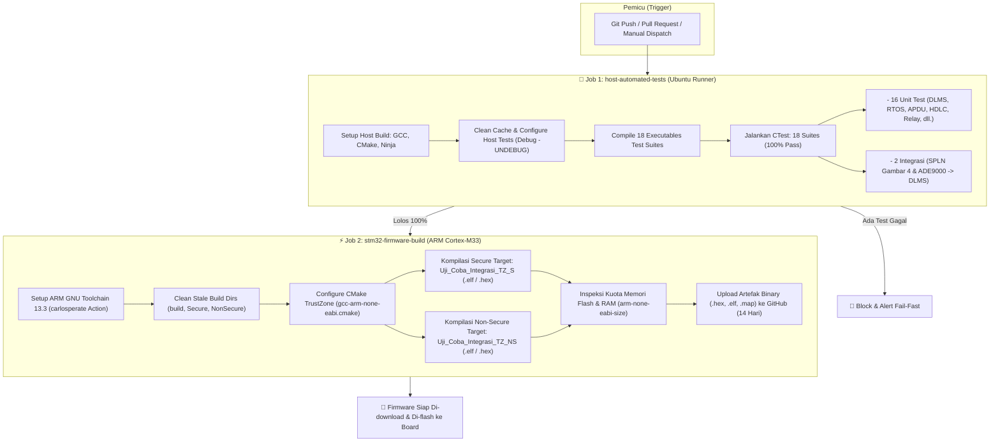
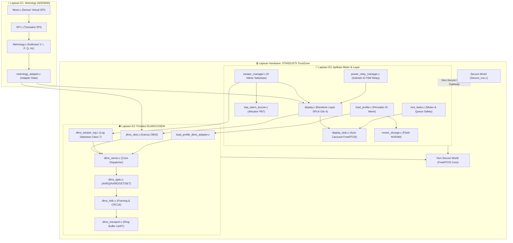

# 📘 Dokumentasi Arsitektur CI/CD & Kontribusi Program (Smart Meter 3-Fasa STM32U575)

Dokumen ini menjelaskan secara menyeluruh tentang sistem **Continuous Integration (CI)** berbasis GitHub Actions dan **bagaimana setiap program/modul di dalam repositori saling terhubung serta berkontribusi** dalam membangun *firmware* Smart Meter 3-Fasa yang tangguh, aman, dan patuh terhadap standar **SPLN D3.006: 2021** serta protokol internasional **DLMS/COSEM (IEC 62056)**.

---

## 1. Arsitektur Pipeline CI (Continuous Integration)

Sistem CI didefinisikan pada file [`.github/workflows/ci.yml`](file:///.github/workflows/ci.yml). CI ini bekerja secara otomatis setiap kali ada `git push` atau `pull request` ke cabang utama (`main`, `master`, `develop`).

---

## 2. Peta Kontribusi Program & Modul

Sistem perangkat lunak ini dibangun dengan arsitektur modular yang terbagi menjadi 5 lapisan utama:
1. **Lapisan E1**: Metrologi & Sensor Emulasi ADE9000
2. **Lapisan E2**: Protokol Komunikasi DLMS/COSEM (IEC 62056)
3. **Lapisan E3**: Aplikasi Smart Meter, Layar SPLN, FSM, & Profiling
4. **Lapisan BSP & Driver**: Abstraksi Perangkat Keras (Hardware Abstraction Layer)
5. **Lapisan Keamanan TrustZone (Secure World)**: Isolasi Kriptografi & Bootloader STM32U575

---

## 3. Rincian Kontribusi Setiap File Program

### A. Lapisan E1: Metrologi Listrik (Analog Devices ADE9000)
Modul ini bertugas mengakuisisi data listrik tiga fasa dari sensor analog:

| File Program | Jalur File | Kontribusi & Fungsi Utama |
| :--- | :--- | :--- |
| `Metrology.c` / `.h` | `E1/Metrology/` | Mengonversi data register mentah ADC dari ADE9000 menjadi nilai teknik riil: Tegangan RMS ($V_A, V_B, V_C$), Arus RMS ($I_A, I_B, I_C, I_N$), Daya Aktif ($P$), Daya Reaktif ($Q$), Daya Semu ($S$), *Power Factor*, Frekuensi Grid, dan Energi Aktif Kumulatif ($kWh$). |
| `Mock.c` / `.h` | `E1/Mock/` | **Kunci Auto-Test CI:** Mensimulasikan chip ADE9000 secara virtual pada memori host/PC, memungkinkan pengujian metrologi tanpa perlu terhubung ke chip fisik atau sumber listrik AC. |
| `SPI.c` / `.h` | `E1/SPI/` | Mengelola protokol komunikasi SPI (16-bit command, 32-bit data, verifikasi CRC-16 ANSI). Pada mode CI, file ini mengarahkan panggilan ke mock virtual. |
| `metrology_adapter.c` | `E1/Adapter/` | Bertindak sebagai jembatan data antara modul metrologi E1 dan struktur data meter terpadu `meter_measurements_t` di sistem E3. |

---

### B. Lapisan E2: Tumpukan Protokol DLMS/COSEM (IEC 62056)
Modul ini mengimplementasikan komunikasi standar internasional smart meter untuk komunikasi AMR/AMI:

| File Program | Jalur File | Kontribusi & Fungsi Utama |
| :--- | :--- | :--- |
| `dlms_hdlc.c` / `.h` | `firmware/protocols/dlms/` | Layer Data Link HDLC (IEC 62056-46). Menangani pembungkusan frame (Flag `0x7E`), format bingkai Type 3 (`0xA000`), kalkulasi FCS CRC16-CCITT polinomial `0x8408`, mekanisme *Byte Stuffing / Destuffing* (`0x7D`), dan Header LLC-SNAP (`0xE6 0xE6 0x00`). |
| `dlms_apdu.c` / `.h` | `firmware/protocols/dlms/` | Layer Aplikasi (IEC 62056-53). Mengodekan dan mengurai paket AARQ (*Application Association Request*), AARE (*Response*), GET-Request, GET-Response, SET-Request, serta pengkodean data tipe A-XDR (Integer, Unsigned, Octet String). |
| `dlms_association.c` / `.h` | `firmware/protocols/dlms/` | Mengontrol siklus hidup sesi koneksi klien meter: transisi status dari `UNASSOCIATED` $\rightarrow$ `ASSOCIATED_READONLY` (Klien Publik) $\rightarrow$ `ASSOCIATED_MANAGEMENT` (Klien Admin). |
| `dlms_obis.c` / `.h` | `firmware/protocols/dlms/` | **Pangkalan Data Kamus OBIS:** Menyediakan pemetaan kode OBIS standar PLN (seperti `1.0.32.7.0.255` untuk Tegangan R, `1.0.1.8.0.255` untuk Total kWh, dan `0.0.96.20.x` untuk *Tamper Counters*). Mendukung pembaruan data dinamis secara *thread-safe*. |
| `dlms_tamper_log.c` / `.h` | `firmware/protocols/dlms/` | Mengelola penyangga sirkular (Circular FIFO Ring Buffer) berkapasitas 30 kejadian sabotase sesuai spesifikasi SPLN D3.006 (Class 7 *Profile Generic* OBIS `0.0.99.98.0.255`). |
| `dlms_server.c` / `.h` | `firmware/protocols/dlms/` | *Engine Dispatcher* utama: memproses aliran byte mentah yang masuk dari UART, mengekstrak frame HDLC yang utuh, mengurai APDU, mencari nilai ke kamus OBIS, dan menyusun frame jawaban balik ke server AMI. |
| `dlms_transport.c` / `.h` | `firmware/protocols/dlms/` | Struktur *generic non-blocking ring buffer* untuk menampung lalu-lintas data byte masuk dari UART DMA. |
| `dlms_nvm.c` / `.h` | `firmware/protocols/dlms/` | Pengelolaan data non-volatile meter yang harus tetap tersimpan saat listrik padam. |
| `dlms_task.c` / `.h` | `firmware/protocols/dlms/` | Pembungkus tugas RTOS (*FreeRTOS task*) agar protokol DLMS berjalan di latar belakang tanpa mengganggu kalkulasi metrologi. |

---

### C. Lapisan E3: Aplikasi Meter, Layar SPLN, FSM, & Relay
Lapisan logika bisnis smart meter sesuai spesifikasi teknis PLN:

| File Program | Jalur File | Kontribusi & Fungsi Utama |
| :--- | :--- | :--- |
| `display.c` / `.h` | `firmware/app/display/` | **Kepatuhan Tampilan SPLN D3.006 Gambar 4:** Menghasilkan frame tampilan layar (Indeks `01` IDPEL, `02..04` Tegangan, `05..07` Arus 3 desimal, `15` Jam RTC WIB, serta halaman khusus sabotase indeks `AL` berstatus `RUSAK` / `PERIKSA` / `REVERSE`). |
| `display_task.c` / `.h` | `firmware/app/display/` | Task FreeRTOS pengatur *auto-carousel* perputaran halaman layar (berganti tiap 5 detik) dan respons seketika terhadap penekanan tombol manual navigasi. |
| `tamper_manager.c` / `.h` | `firmware/app/tamper/` | Mengawasi 9 vektor sabotase: *Case Open*, *Terminal Open*, Medan Magnetik, Arus Terbalik (*Reverse*), *Neutral Bypass*, Hilang Fasa, dll. Memicu status darurat `!ALM` dan refresh seketika pada layar OLED. |
| `power_relay_manager.c` / `.h` | `firmware/app/fsm/` | **Kontrol Pemutus Beban (Relay):** Mendeteksi asimetri beban fase $>30\%$ (SPLN Tabel 5 No 11), *overload power limiter trip* dengan durasi toleransi (No 13), dan FSM pemulihan relay status `READY ON` yang mewajibkan konfirmasi penekanan tombol lokal (No 12). |
| `fsm_statechart.c` / `.h` | `firmware/app/fsm/` | State machine pengatur kondisi operasional meter (Inisialisasi, Normal Metering, Low Power Mode saat padam, dan Tamper Lockout). |
| `rtos_tasks.c` / `.h` | `firmware/app/fsm/` | Titik orkestrasi FreeRTOS: menginisialisasi mutex pelindung data meter, antrean pesan (*queues*), task produser event tamper, task konsumen DLMS, dan aktuasi sinyal PB7 buzzer. |
| `load_profile.c` / `.h` | `firmware/app/profiling/` | Perekam data histori beban periodik 15-menit (*Load Profile ER-02*) yang mencatat snapshot energi aktif, reaktif, tegangan, dan arus lengkap dengan checksum integritas CRC-16. |
| `load_profile_dlms_adapter.c` | `firmware/app/profiling/` | Menjembatani buffer load profile internal ke dalam format standar DLMS *Profile Generic* (Class 7) agar dapat diunduh oleh head-end system PLN. |
| `nvram_storage.c` / `.h` | `firmware/app/profiling/` | Abstraksi memori NVRAM untuk menyimpan snapshot load profile dan event log ke media penyimpanan permanen. |
| `console_io.c` / `.h` | `firmware/app/console/` | Modul komunikasi konsol serial UART universal untuk pemantauan diagnostik engineering. |

---

### D. Lapisan BSP (Board Support Package) & Driver
Menghubungkan kode perangkat lunak dengan pin dan modul periferal mikrokontroler STM32U575:

| File Program | Jalur File | Kontribusi & Fungsi Utama |
| :--- | :--- | :--- |
| `bsp_lpuart_dma.c` / `.h` | `firmware/drivers/bsp/` | Driver Low-Power UART (LPUART1) dengan DMA melingkar (*circular DMA*) untuk efisiensi komunikasi serial tanpa membebani CPU. |
| `bsp_display_oled.c` / `.h` | `firmware/drivers/bsp/` | Driver komunikasi I2C ke panel display grafis OLED SSD1306 (resolusi $128 \times 64$). |
| `bsp_alarm_buzzer.c` / `.h` | `firmware/drivers/bsp/` | Driver aktuasi hardware pada pin **PB7**: mengendalikan bunyi buzzer intermiten dan lampu indikator alarm sabotase. |

---

### E. Lapisan Target STM32U575 TrustZone (Hardware Implementation)
Menyediakan perlindungan tingkat perangkat keras berbasis ARMv8-M TrustZone:

| Komponen | Jalur File | Kontribusi & Fungsi Utama |
| :--- | :--- | :--- |
| **Secure World** | `Secure/` | Domain memori terlindungi hardware: menyimpan kunci enkripsi rahasia, bootloader aman, konfigurasi SAU (*Security Attribution Unit*), serta menyediakan gerbang NSC (*Non-Secure Callable*) via `secure_nsc.c` dan `Secure_nsclib/secure_nsclib.o`. |
| **Non-Secure World** | `NonSecure/` | Domain tempat seluruh aplikasi meter berjalan: kernel FreeRTOS, task metrologi, display OLED, pembacaan tombol, dan komunikasi DLMS. Jika domain ini diserang atau mengalami crash, kunci rahasia pada Secure World tetap tidak dapat ditembus. |

---

## 4. Rincian 18 Test Suites yang Dijalankan oleh CI

Setiap kali CI berjalan di GitHub Actions, sistem mengeksekusi 18 program pengujian berikut:

| No | Target Test | Program Sumber | Apa yang Divalidasi oleh Program Ini? |
| :---: | :--- | :--- | :--- |
| 1 | `test_dlms_association` | `test_dlms_association.c` | Memvalidasi jabat tangan AARQ/AARE, otentikasi klien, dan isolasi izin baca-saja (*read-only*). |
| 2 | `test_dlms_apdu` | `test_dlms_apdu.c` | Memvalidasi akurasi serialisasi/parsing APDU GET-Request, response tipe numerik, dan octet string. |
| 3 | `test_dlms_integration` | `test_dlms_integration.c` | Siklus lengkap: SNRM $\rightarrow$ UA $\rightarrow$ AARQ $\rightarrow$ AARE $\rightarrow$ GET Request OBIS $\rightarrow$ DISC $\rightarrow$ UA. |
| 4 | `test_dlms_tamper_log` | `test_dlms_tamper_log.c` | Memvalidasi struktur 30 rekaman sirkular sabotase FIFO, overflow retention, dan serialisasi A-XDR Class 7. |
| 5 | `test_dlms_hdlc` | `test_dlms_hdlc.c` | Memvalidasi framing HDLC, kebenaran tabel FCS CRC16-CCITT, byte-stuffing flag `0x7E` dan escape `0x7D`. |
| 6 | `test_dlms_server` | `test_dlms_server.c` | Memvalidasi server dispatcher memproses buffer ring UART dan mengisolasi akses ilegal. |
| 7 | `test_dlms_task` | `test_dlms_task.c` | Memvalidasi interaksi antrean task DLMS dalam memproses event asinkron. |
| 8 | `test_dlms_nvm` | `test_dlms_nvm.c` | Memvalidasi penyimpanan parameter non-volatile dan integritas data saat meter kehilangan daya. |
| 9 | `test_bsp_lpuart` | `test_bsp_lpuart.c` | Menguji modul LPUART emulasi host, ring buffer, dan penanganan overflow byte masuk. |
| 10 | `test_e3_app` | `test_e3_app.c` | Memvalidasi pemetaan struktur pengukuran metrologi ke display renderer dan log tamper. |
| 11 | `test_fsm_statechart` | `test_fsm_statechart.c` | Memvalidasi 100% transisi status FSM operasional daya (State 0 hingga State 5). |
| 12 | `test_load_profile` | `test_load_profile.c` | Memvalidasi perekaman periodik 15-menit, perhitungan CRC-16, dan wrap-around ring buffer. |
| 13 | `test_load_profile_dlms_adapter` | `test_load_profile_dlms_adapter.c` | Memvalidasi format A-XDR buffer profil beban saat diminta via OBIS DLMS Class 7. |
| 14 | `test_nvram_storage` | `test_nvram_storage.c` | Memvalidasi penyimpanan dan pemulihan snapshot data tamper dan load profile pada NVRAM. |
| 15 | `test_rtos_tasks` | `test_rtos_tasks.c` | Menguji pengiriman event dari task produser tamper ke task konsumen DLMS dan aktuasi buzzer PB7. |
| 16 | `test_power_relay` | `test_power_relay.c` | Memvalidasi proteksi asimetri daya, durasi pemutus beban, dan status `READY ON` konfirmasi tombol lokal. |
| 17 | `test_spln_display_tamper` | `test_spln_display_tamper.c` | **Standar SPLN Gambar 4:** Memvalidasi 9 kode sabotase Tabel 6 dan 8 kode alarm internal Tabel 4. |
| 18 | `test_e1_to_e2_integration` | `test_e1_to_e2_integration.c` | **Integrasi Penuh:** Virtual ADE9000 SPI (E1) $\rightarrow$ Buffer Pengukuran (E3) $\rightarrow$ DLMS OBIS (E2). |

---

## 5. Ringkasan Nilai Tambah Pipeline CI

1. **Kecepatan Umpan Balik (*Fast Feedback*)**: Seluruh 18 pengujian host selesai hanya dalam waktu **0.3 - 0.9 detik** di runner Ubuntu.
2. **Keamanan Kode (*Zero Regression*)**: Menjamin bahwa modifikasi pada satu file (misalnya rumus metrologi) tidak merusak protokol komunikasi atau tampilan layar SPLN.
3. **Firmware Otomatis Siap Pakai (*Automated Artifacts*)**: Setiap kali kompilasi lolos, GitHub otomatis memproduksi dan menyimpan file binary `.hex` dan `.elf` untuk Secure World dan Non-Secure World tanpa perlu kompilasi manual di STM32CubeIDE.

