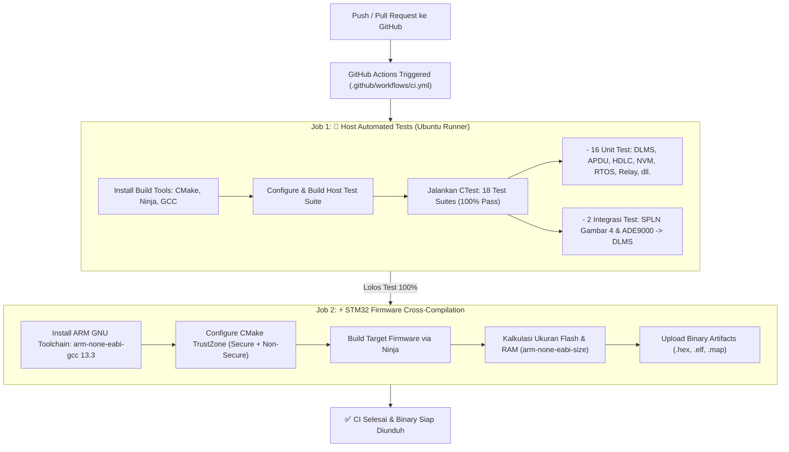

# 🚀 Panduan Otomatisasi Pengujian (Auto Test & CI/CD) di GitHub Actions

Dokumen ini menjelaskan arsitektur, cara kerja, dan konfigurasi pengujian otomatis (**Continuous Integration / CI**) pada GitHub Actions untuk proyek Smart Meter 3-Fasa STM32U575 (TrustZone: Secure + Non-Secure).

---

## 1. Arsitektur Pengujian di GitHub Actions

Sistem CI di GitHub Actions dirancang dengan **2 Job Utama**:



---

## 2. Rincian Pengujian yang Berjalan Otomatis

### A. Pengujian Unit & Integrasi Host (18 Test Suites)
Pengujian ini berjalan secara native di runner Ubuntu Linux menggunakan compiler GCC standar, mengeksekusi logika firmware dalam hitungan milidetik tanpa memerlukan board fisik:

| No | Nama Target Test | Komponen yang Diuji | Status |
| :---: | :--- | :--- | :---: |
| 1 | `test_dlms_association` | DLMS Application Association (AARQ / AARE) | ✅ PASS |
| 2 | `test_dlms_apdu` | Parser & Serializer APDU DLMS/COSEM | ✅ PASS |
| 3 | `test_dlms_integration` | Siklus Transaksi HDLC + APDU + Kamus OBIS | ✅ PASS |
| 4 | `test_dlms_tamper_log` | Buffer Sirkular Event Log Sabotase (OBIS 0.0.99.98.0) | ✅ PASS |
| 5 | `test_dlms_hdlc` | Framing HDLC, Frame Check Sequence (FCS CRC16) | ✅ PASS |
| 6 | `test_dlms_server` | Server State Machine (Unassociated, ReadOnly, Management) | ✅ PASS |
| 7 | `test_dlms_task` | Antrean RTOS & Pemrosesan Frame Asinkron | ✅ PASS |
| 8 | `test_dlms_nvm` | Penyimpanan Non-Volatile Virtual Meter & OBIS | ✅ PASS |
| 9 | `test_bsp_lpuart` | Simulasi Driver Low-Power UART & DMA Buffer | ✅ PASS |
| 10 | `test_e3_app` | Integrasi Pengukuran E3 & Parsing Snapshot | ✅ PASS |
| 11 | `test_fsm_statechart` | FSM Power Management & Transisi Status | ✅ PASS |
| 12 | `test_load_profile` | Perekaman Load Profile 15-Menit & Interval | ✅ PASS |
| 13 | `test_load_profile_dlms_adapter` | Adapter Penyelarasan Load Profile ke Kamus OBIS | ✅ PASS |
| 14 | `test_nvram_storage` | Partisi dan Integritas NVRAM Emulasi | ✅ PASS |
| 15 | `test_rtos_tasks` | Sinkronisasi Mutex, Antrean, dan Thread Safety | ✅ PASS |
| 16 | `test_power_relay` | Logika Pemutus Beban (Relay Disconnect / Reconnect) | ✅ PASS |
| 17 | `test_spln_display_tamper` | **SPLN D3.006 Gambar 4 Layout + 9 Sabotase Tabel 6 + 8 Alarm Tabel 4** | ✅ PASS |
| 18 | `test_e1_to_e2_integration` | **Alur Penuh: ADE9000 Mock SPI (E1) -> Meas Buffer (E3) -> DLMS OBIS (E2)** | ✅ PASS |

---

## 3. Struktur File Workflow GitHub

File workflow telah dibuat di:
```text
.github/
└── workflows/
    └── ci.yml
```

### Fitur Workflow `ci.yml`:
1. **Trigger Otomatis**:
   - Berjalan pada setiap `git push` ke cabang `main`, `master`, atau `develop`.
   - Berjalan pada setiap pembuatan `pull_request`.
   - Dapat dijalankan secara manual dari tab **Actions** di GitHub (`workflow_dispatch`).
2. **Fail-Fast**:
   - Jika ada unit test yang gagal (`assert` fail), proses CI langsung dihentikan dan ditandai merah (merah = gagal), mencegah kode rusak masuk ke branch utama.
3. **Artifacts Penyimpanan Otomatis**:
   - Binary firmware (`.elf`, `.hex`, `.map`) untuk Secure dan Non-Secure otomatis diarsipkan di GitHub Actions dan dapat langsung diunduh selama 14 hari.

---

## 4. Cara Menjalankan & Memverifikasi di GitHub

### Langkah 1: Push Perubahan ke GitHub
Jalankan perintah berikut di terminal lokal:
```bash
git add .github/workflows/ci.yml .gitignore Uji_Coba_Integrasi_TZ/firmware/CMakeLists.txt Uji_Coba_Integrasi_TZ/NonSecure/firmware/CMakeLists.txt
git commit -m "feat: Add GitHub Actions CI for 18 automated test suites and STM32 firmware build"
git push origin main
```

### Langkah 2: Memantau Proses Pengujian di GitHub UI
1. Buka repositori Anda di browser: `https://github.com/Kevla27/Ngandelmen`
2. Klik tab **Actions** di bilah navigasi atas.
3. Anda akan melihat workflow yang sedang berjalan: **CI - Smart Meter Firmware & Automated Tests**.
4. Klik workflow tersebut untuk melihat log proses per-tahap secara langsung:
   - Log eksekusi 18 test suite di `host-automated-tests`.
   - Log kompilasi ARM dan ukuran ROM/RAM di `stm32-firmware-build`.

### Langkah 3: Mengunduh Hasil Kompilasi Firmware
1. Setelah workflow selesai dengan status hijau (✅), gulir ke bagian paling bawah halaman eksekusi workflow tersebut.
2. Pada bagian **Artifacts**, klik **stm32-firmware-binaries**.
3. File `.zip` akan terunduh, berisi file `.hex` dan `.elf` yang siap di-flash langsung ke board STM32 menggunakan STM32CubeProgrammer!

---

## 5. Cara Menjalankan Pengujian Serupa di Komputer Lokal

Sebelum melakukan push ke GitHub, Anda dapat menjalankan seluruh rangkaian 18 pengujian secara lokal dengan perintah:

```powershell
cd Uji_Coba_Integrasi_TZ/firmware
cmake -B build -S . -GNinja
cmake --build build
ctest --test-dir build --output-on-failure
```
*(Seluruh 18 pengujian selesai dalam waktu kurang dari 1 detik)*

