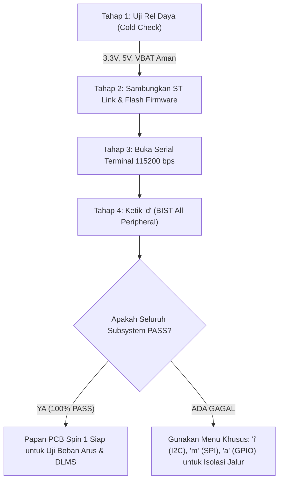

# PANDUAN LENGKAP ARSITEKTUR & PENGOPERASIAN FIRMWARE
# SMART METER 3-FASA (SPLN D3.006: 2021 & IEC 62056 DLMS/COSEM)
### Platform Mikrokontroler: STM32U575 (ARM Cortex-M33 TrustZone) & ADE9000

---

## DAFTAR ISI
1. [Ringkasan Eksekutif & Identitas Proyek](#1-ringkasan-eksekutif--identitas-proyek)
2. [Standar Acuan Regulasi PLN & IEC](#2-standar-acuan-regulasi-pln--iec)
3. [Arsitektur Keamanan ARM TrustZone (Secure vs Non-Secure)](#3-arsitektur-keamanan-arm-trustzone)
4. [Struktur Folder & Modularitas Kode Sumber](#4-struktur-folder--modularitas-kode-sumber)
5. [Pembagian Tugas Tim Engineering (E1, E2, E3)](#5-pembagian-tugas-tim-engineering-e1-e2-e3)
6. [Arsitektur Kernel FreeRTOS & Thread-Safety (IPC)](#6-arsitektur-kernel-freertos--thread-safety-ipc)
7. [Subsystem Hardware Abstraction Layer (BSP Drivers)](#7-subsystem-hardware-abstraction-layer-bsp-drivers)
   - 7.1. Driver Interupsi ADE9000 (Top-Half / Bottom-Half SPI)
   - 7.2. Driver Offline Tamper (STM32 TAMP & Backup Domain VBAT)
   - 7.3. Driver PVD Brownout & Last-Gasp Flash Save
   - 7.4. Driver Multi-Task Watchdog Supervisor (STM32 IWDG)
   - 7.5. Driver Display Layar Carousel (SPLN D3.006-1 Gambar 4)
   - 7.6. Driver Aktuator Relai & Buzzer Alarm
8. [Basis Data & Penyimpanan Non-Volatile (NVRAM & Load Profile)](#8-basis-data--penyimpanan-non-volatile)
9. [Protokol Komunikasi DLMS/COSEM (E2 Stack)](#9-protokol-komunikasi-dlmscosem)
10. [Panduan Konsol Interaktif UART (CLI Hotkeys)](#10-panduan-konsol-interaktif-uart-cli-hotkeys)
11. [Panduan Uji Otomatis Host PC (24 Test Suites CTest)](#11-panduan-uji-otomatis-host-pc-24-test-suites-ctest)
12. [Panduan Prosedur Hardware Bring-Up PCB Spin 1 (BIST)](#12-panduan-prosedur-hardware-bring-up-pcb-spin-1-bist)
13. [Petunjuk Kompilasi & Build System](#13-petunjuk-kompilasi--build-system)

---

## 1. RINGKASAN EKSEKUTIF & IDENTITAS PROYEK

Firmware ini adalah sistem operasi meteran listrik prabayar/pascabayar 3-fasa canggih (*Advanced Metering Infrastructure - AMI*) yang dirancang khusus untuk memenuhi standar teknis **PT PLN (Persero)** dan standar komunikasi internasional **DLMS User Association**.

### Spesifikasi Inti Sistem:
- **Mikrokontroler:** STM32U575VGT6 (ARM Cortex-M33 @ 160 MHz, FPU, MPU, TrustZone, 1 MB Flash, 786 KB SRAM).
- **Prosesor Pengukuran (Metrologi):** Analog Devices ADE9000 (Polyphase Energy Metering AFE via High-Speed SPI).
- **Sistem Operasi Real-Time:** FreeRTOS Kernel V10.x (Pre-emptive Scheduler, Tick Rate: 1.000 Hz).
- **Domain Daya Cadangan:** Baterai Litium Primer 3.6V ER14250 terhubung ke pin $V_{BAT}$ (Arus siaga $< 500\text{ nA}$, masa pakai $> 15\text{ tahun}$).
- **Antarmuka Komunikasi:**
  - Port Optik Lokal: LPUART1 @ 9600 / 115200 bps (IEC 62056-21 / DLMS HDLC).
  - Port Modem / ST-Link VCP: USART1 @ 115200 bps (Debugging, BIST, CLI, dan Uplink Modem).
- **Layar Tampilan:** Agnostik Hardware (Mendukung OLED 128x32 via I2C dan Kaca LCD Segmen Monokrom Kustom PLN Gambar 4).

---

## 2. STANDAR ACUAN REGULASI PLN & IEC

Firmware ini tunduk dan patuh secara ketat terhadap dokumen spesifikasi berikut:

| Regulasi / Standar | Bagian / Pasal | Deskripsi Implementasi pada Firmware |
| :--- | :--- | :--- |
| **SPLN D3.006: 2021** | Bagian 5 & Tabel 6 | **Daftar Sabotase & Penanganan:** Tutup meter dibuka (**RUSAK**), tutup terminal dibuka (**ERR20**), urutan fasa terbalik (**ERR21**), pengawatan silang (**ERR22**), kawat netral putus (**ERR23**), hilang tegangan fasa (**ERR24**), induksi medan magnet (**ERR25**), arus balik (**ERR26**), dan faktor daya rendah (**ERR27**). |
| **SPLN D3.006: 2021** | Tabel 4 | **Alarm Internal Kerusakan Komponen:** Kerusakan mikroprosesor / Watchdog Reset (**ERR04**), kegagalan memori Flash (**ERR00**), RTC error (**ERR02**), dan baterai lemah (**ERR03**). |
| **SPLN D3.006: 2021** | Tabel 5 | **Pengendalian Beban & Relai Pemutus:** Pembatas daya aktif (*Power Limiter* No 13), deteksi asimetri beban fasa No 11, dan prosedur *Remote Reconnect* dengan konfirmasi lokal (**READY ON** No 12). |
| **SPLN D3.006-1: 2017**| Gambar 4 | **Format Tampilan Layar:** Format Kode Tarif / Indeks (ZZ), Kode OBIS baku, Nilai Pengukuran, Satuan Baku, dan Ikon Status Sabotase. |
| **IEC 62056-5-3 / 6-2** | DLMS/COSEM | Komunikasi protokol: Asosiasi Management/Public Client, Profil Beban (*Load Profile P.01*), dan Profil Kejadian (*Tamper Event Logbook* 30 entri FIFO). |

---

## 3. ARSITEKTUR KEAMANAN ARM TRUSTZONE

Firmware mengimplementasikan isolasi keamanan perangkat keras menggunakan ARM TrustZone (Cortex-M33 Security Extensions):

```
+-----------------------------------------------------------------------------------+
|                            STM32U575 TRUSTZONE ARCHITECTURE                       |
+-----------------------------------------+-----------------------------------------+
|        SECURE WORLD (Aman / Root)       |     NON-SECURE WORLD (Aplikasi Meter)   |
+-----------------------------------------+-----------------------------------------+
| - Konfigurasi Jam Sistem (PLL 160 MHz)   | - Kernel FreeRTOS & Seluruh Task        |
| - Konfigurasi Flash Option Bytes / SAU  | - Subsystem Metrologi E1 (ADE9000 SPI)  |
| - Penanganan Sensor Tamper Fisik PC13   | - Subsystem Komunikasi DLMS/COSEM E2    |
| - Non-Secure Callable (NSC) Gateways:   | - Subsystem Aplikasi, Tampilan & FSM E3 |
|   * SECURE_SystemReset()                | - Driver Layar (OLED/LCD), Relai, Buzzer|
|   * SECURE_RegisterCallback()           | - Penyimpanan Profil Beban & Logbook    |
+-----------------------------------------+-----------------------------------------+
                    |                                          ^
                    +--- Non-Secure Callable (NSC Library) ----+
```

### Karakteristik Partisi:
1. **Secure World:** Mengamankan vektor interupsi kritis, proteksi bootloader, dan mengisolasi pin sabotase fisik `PC13`. Ketika microswitch penutup meter dibuka, interupsi EXTI13 diproses terlebih dahulu di Secure World sebelum diteruskan melalui gateway *Non-Secure Callable* ke Non-Secure World.
2. **Non-Secure World:** Berisi seluruh aplikasi meteran yang fleksibel, penjadwal FreeRTOS, parser protokol DLMS, algoritma proteksi relai, dan antarmuka display.

---

## 4. STRUKTUR FOLDER & MODULARITAS KODE SUMBER

```text
Uji_Coba_Integrasi_TZ/
├── Secure/                         # Proyek ARM Cortex-M33 Secure World
│   ├── Core/Src/main.c             # Inisialisasi clock 160MHz, MPU/SAU, dan NSC Gate
│   └── Secure_nsclib/secure_nsc.h  # Header antarmuka fungsi gerbang aman NSC
├── NonSecure/                      # Proyek ARM Cortex-M33 Non-Secure World
│   ├── Core/Src/main.c             # Entry point aplikasi meter, FreeRTOS launch, CLI UART
│   └── CMakeLists.txt              # Build configuration cross-compile ARM GCC
├── firmware/                       # Core Source Code Firmware (Dual-Target: ARM & PC)
│   ├── app/                        # Lapisan Logika Aplikasi (E3)
│   │   ├── console/                # Universal Console I/O (printf retargeting)
│   │   ├── display/                # Engine Tampilan Layar SPLN Gambar 4 & OLED Carousel
│   │   ├── fsm/                    # Statechart Meter, Power Relay Manager, FreeRTOS Tasks
│   │   ├── profiling/              # Basis Data Profil Beban 15-Menit & NVRAM Flash Storage
│   │   └── tamper/                 # Pengelola Kejadian Sabotase (Tamper Event Manager)
│   ├── drivers/bsp/                # Board Support Package (Hardware Abstraction Layer)
│   │   ├── inc/bsp_pin_mapping.h   # Pemetaan pin terpusat (PCB Pinout Configuration)
│   │   ├── inc/bsp_ade9000_irq.h   # Interupsi ADE9000 IRQ0/IRQ1 Deferred Architecture
│   │   ├── inc/bsp_alarm_buzzer.h  # Kendali Buzzer & LED Alarm PB7
│   │   ├── inc/bsp_bringup_test.h  # Built-In Self-Test (BIST) Hardware Bring-Up Spin 1
│   │   ├── inc/bsp_display_oled.h  # Driver Layar OLED SSD1306 (128x32) I2C
│   │   ├── inc/bsp_lpuart_dma.h    # Driver Komunikasi LPUART1 DMA Optik
│   │   ├── inc/bsp_pvd.h           # Programmable Voltage Detector (Last-Gasp Save)
│   │   ├── inc/bsp_rtc_tamp.h      # Offline Tamper & Backup Domain VBAT (PC13)
│   │   └── inc/bsp_watchdog.h      # Multi-Task Heartbeat Watchdog Supervisor (IWDG)
│   ├── protocols/dlms/             # Lapisan Protokol Komunikasi (E2)
│   │   ├── inc/dlms_types.h        # Struktur dasar, OBIS code, result codes
│   │   ├── inc/dlms_apdu.h         # Parser & Encoder APDU (AARQ, AARE, GET, SET)
│   │   ├── inc/dlms_hdlc.h         # Framing HDLC, FCS-16, Byte Stuffing
│   │   ├── inc/dlms_obis.h         # Kamus Objek OBIS Standar PLN
│   │   ├── inc/dlms_server.h       # Dispatcher Server DLMS & State Machine
│   │   ├── inc/dlms_tamper_log.h   # Logbook Tamper Class 7 Profile Generic (30 FIFO)
│   │   └── inc/dlms_task.h         # FreeRTOS DLMS Server Task Context
│   ├── tests/                      # Suite Pengujian Unit & Integrasi CTest (24 Suites)
│   │   ├── app/                    # Uji FSM, Profil Beban, Relay, Stress/Soak Test
│   │   ├── drivers/                # Uji Driver BSP (ADE9000, Watchdog, PVD, TAMP, BIST)
│   │   └── protocols/              # Uji Protokol DLMS (HDLC, APDU, Server, Tamper Log)
│   └── CMakeLists.txt              # CMake Build System untuk Unit Test PC (MinGW GCC)
└── rangkuman/                      # Seluruh Laporan Audit, Diagram, dan Panduan Teknis
```

---

## 5. PEMBAGIAN TUGAS TIM ENGINEERING (E1, E2, E3)

Firmware ini disusun secara modular untuk memisahkan tanggung jawab kerja antar-insinyur:

```
+-----------------------------------------------------------------------------------+
|               KOLABORASI MODULAR TIM SMART METER 3-FASA                          |
+-----------------------------------------------------------------------------------+
       |
       +---> [E1 - METROLOGY ENGINEER]
       |     - Chip: ADE9000 via SPI Bus Terlindungi (Protected SPI Mutex).
       |     - Tugas: Sampling data V, I, P, Q, S, PF, Frekuensi, dan Energi.
       |     - Sinyal Darurat: Interupsi Hardware EXTI PB0 (IRQ0) & PB1 (IRQ1).
       |     - Adaptor: `metrology_adapter.c` mengubah raw register ke format E3.
       |
       +---> [E2 - PROTOCOL & COMMUNICATION ENGINEER]
       |     - Protokol: IEC 62056 DLMS/COSEM HDLC Profile.
       |     - Antarmuka: LPUART1 DMA (Optik) dan USART1 (Modem/VCP).
       |     - Tugas: Menjawab AARQ/AARE dari HES PLN, eksekusi APDU GET/SET, 
       |       menyajikan data profil beban (P.01), dan serialisasi A-XDR log tamper.
       |
       +---> [E3 - APPLICATION, DISPLAY, SAFETY & STORAGE ENGINEER (Peran Utama)]
             - Kernel: Konfigurasi FreeRTOS, alokasi prioritas, antrean, dan mutex.
             - Statechart: FSM Meter & Power Relay Manager (Trip, Reconnect, Ready On).
             - Tamper Manager: Deteksi 9 jenis sabotase SPLN Tabel 6 (Online & Offline).
             - Display: Formatter Layar Standar SPLN Gambar 4 & OLED/LCD Engine.
             - Keandalan: Watchdog Supervisor, PVD Last-Gasp Flash Save, Soak Test.
```

---

## 6. ARSITEKTUR KERNEL FREERTOS & THREAD-SAFETY (IPC)

Sistem operasi mengelola 6 task independen yang berkomunikasi menggunakan mekanisme *Thread-Safe Inter-Process Communication*:

### 6.1. Matriks Task FreeRTOS

| Nama Task | Prioritas | Alokasi Stack | Periode Eksekusi | Deskripsi Tugas Utama |
| :--- | :---: | :---: | :---: | :--- |
| **`ADE9000_IRQ`** | **5** (Tertinggi) | 256 words | Event-Driven (EXTI) | Memproses interupsi arus balik, kawat netral hilang, dan voltage sag secara deferred. |
| **`TamperTask`** | **4** (High) | 256 words | Setiap 200 ms | Memonitor alarm sabotase, mengendalikan buzzer/LED cadence, dan memutus relai beban. |
| **`ProfileTask`** | **3** (Medium) | 512 words | Setiap 1.000 ms | Membaca sampling metrologi E1, evaluasi pembatas daya (*Power Limiter*), dan membekukan profil beban 15-menit. |
| **`DLMSTask`** | **2** (Normal) | 1024 words | Setiap 10 ms | Mengurai paket serial HDLC DLMS dan melayani permintaan data dari HES PLN. |
| **`WdgSupervisor`**| **2** (Normal) | 256 words | Setiap 1.000 ms | Memverifikasi heartbeat seluruh task dan me-refresh hardware IWDG. |
| **`OLEDTask`** | **1** (Low) | 512 words | Setiap 100 ms | Mengelola rotasi otomatis layar carousel SPLN Gambar 4 setiap 5 detik. |

### 6.2. Mekanisme Sinkronisasi & Mutex
1. **`xMeasMutex` (Mutex Pengukuran):** Mengamankan pembacaan dan penulisan struktur `meter_measurements_t`. Mencegah terjadinya data korup saat `ProfileTask` sedang mengupdate tegangan/arus sementara `DLMSTask` atau `OLEDTask` sedang membacanya.
2. **`s_spi_mutex` (Mutex Bus SPI ADE9000):** Mencegah perebutan bus SPI antara pembacaan periodik 1 detik dan pembacaan interupsi mendadak dari `ADE9000_IRQ`.
3. **`xTamperQueue` (Queue Pesan Sabotase):** Buffer antrean 10 entri untuk mengirim sinyal sabotase dari ISR ke `TamperTask` dan `DLMSTask`.

---

## 7. SUBSYSTEM HARDWARE ABSTRACTION LAYER (BSP DRIVERS)

Seluruh driver perangkat keras dirancang modular di dalam folder `firmware/drivers/bsp/` dengan pemetaan pin terpusat pada [`bsp_pin_mapping.h`](file:///g:/PPPP/Day_Sekian/Uji_Coba_Integrasi_TZ/firmware/drivers/bsp/inc/bsp_pin_mapping.h).

### 7.1. Driver Interupsi ADE9000 (`bsp_ade9000_irq.c/.h`)
- **Pin Hardware:** `PB0` (IRQ0) dan `PB1` (IRQ1).
- **Arsitektur Deferred Bottom-Half:**
  - *Top-Half (ISR):* Berjalan dalam orde sub-mikrodetik ($< 1\text{ }\mu\text{s}$), hanya mencatat bendera interupsi dan membangkitkan `ADE9000_IRQ Worker Task` via FreeRTOS Direct Task Notification (`vTaskNotifyGiveFromISR`). Tidak ada transaksi SPI atau printf di dalam ISR!
  - *Bottom-Half (Worker Task):* Berjalan di konteks thread (Priority 5), mengunci `s_spi_mutex`, membaca register `STATUS0`/`STATUS1`, melakukan *Write-1-to-Clear*, dan meneruskan pesan sabotase ke antrean RTOS.

### 7.2. Driver Offline Tamper (`bsp_rtc_tamp.c/.h`)
- **Pin Hardware:** `PC13` terhubung secara internal ke kanal `TAMP_IN1`.
- **Operasi Baterai ($V_{BAT}$):** Beroperasi saat catu daya PLN padam total ($V_{DD} = 0\text{V}$) dengan konsumsi arus $< 500\text{ nA}$ dari baterai ER14250 3.6V.
- **Penyimpanan:** Menyimpan status dan timestamp kejadian di `TAMP_BKP0R` (Marker `0xA55A` + Kode Tamper) dan `TAMP_BKP1R` (Timestamp).
- **Pemulihan Booting:** Saat listrik kembali menyala, fungsi `bsp_rtc_tamp_process_offline_events()` mengekstrak data dari Backup Register, menyuntikkannya ke logbook DLMS, menyalakan tulisan **"RUSAK"** di layar, dan membersihkan flag di register `TAMP_SCR` (*single-shot recovery*).

### 7.3. Driver PVD Brownout & Last-Gasp Flash Save (`bsp_pvd.c/.h`)
- **Periferal:** STM32 *Programmable Voltage Detector* (PVD Level 6, threshold $2,9\text{ V}$).
- **Mekanisme Last-Gasp:** Ketika tegangan $V_{DD}$ anjlok di bawah 2.9V akibat pemadaman listrik, interupsi PVD memicu fungsi darurat untuk menyimpan snapshot energi kumulatif dan seluruh logbook sabotase ke memori Flash internal sebelum daya kapasitor habis total.

### 7.4. Driver Multi-Task Watchdog Supervisor (`bsp_watchdog.c/.h`)
- **Periferal Hardware:** STM32 IWDG (*Independent Watchdog*) beroperasi dari clock LSI 32 kHz independen (Prescaler /64, Timeout: 3,0 detik).
- **Multi-Task Heartbeat:** Setiap task menyetorkan bit tanda hidup: Tamper (`0x01`), Metrologi (`0x02`), DLMS (`0x04`), UI (`0x08`), dan ADE9000 IRQ (`0x10`).
- **Pencegahan False Refresh:** Supervisor mengevaluasi setiap 1,0 detik. Jika ada satu task yang macet, supervisor **menolak me-refresh IWDG**, membiarkan hardware IWDG me-reset MCU secara paksa. Saat boot, status reset dicatat sebagai **ERR04** dan akumulator di `TAMP_BKP3R` bertambah.

### 7.5. Driver Display Layar Carousel (`display_task.c`, `display.c`)
- **Standar:** SPLN D3.006-1: 2017 Gambar 4.
- **Carousel Otomatis:** Berpindah halaman setiap 5 detik:
  1. Halaman 1: ID Pelanggan / Nomor Seri Meter (OBIS `0.0.96.1.0.255`).
  2. Halaman 2: Total Energi Aktif Impor kWh (OBIS `1.0.1.8.0.255`).
  3. Halaman 3: Tegangan & Arus Fasa R/S/T (OBIS `1.0.32.7.0.255`, dll).
  4. Halaman Darurat: Tampilan **"RUSAK"** atau **"ERR20"** seketika saat terdeteksi sabotase.
  5. Halaman Kontrol: Tampilan peringatan **"READY ON"** saat relai siap disambungkan kembali.

### 7.6. Driver Aktuator Relai & Buzzer Alarm (`bsp_alarm_buzzer.c/.h`, `power_relay_manager.c/.h`)
- **Buzzer & LED Alarm (`PB7`):**
  - Cadence 200 ms ON / 200 ms OFF: Peringatan Darurat Sabotase.
  - Cadence 400 ms ON / 400 ms OFF: Peringatan Relai *READY ON* (SPLN Tabel 5 No 12).
- **Relai Pemutus Beban (`PC8` Trip, `PC9` Close):**
  - Mengendalikan koil *latching relay* menggunakan pulsa 50 ms.
  - Mendukung fungsi pembatas daya aktif (*Power Limiter*) dan proteksi beban asimetris 3-fasa.

---

## 8. BASIS DATA & PENYIMPANAN NON-VOLATILE

Firmware mengelola dua basis data transaksional utama:

### 8.1. Profil Beban 15-Menitan (Load Profile P.01)
- **Modul:** [`load_profile.c/.h`](file:///g:/PPPP/Day_Sekian/Uji_Coba_Integrasi_TZ/firmware/app/profiling/inc/load_profile.h).
- **Format Entri:** *72-byte compact record* memuat: Timestamp UNIX, Tegangan R/S/T, Arus R/S/T/N, Daya Aktif/Reaktif, Power Factor, Energi Impor/Ekspor Wh/varh, Status Bitmask, dan Checksum CRC-16 (CCITT-FALSE).
- **Kapasitas:** *Ring buffer* sirkular di RAM dan dipetakan ke Flash NVRAM Bank 2 (`0x081F4000`). Teruji mampu berputar (*wrap-around*) lebih dari 86 kali putaran penuh (simulasi 90 hari) tanpa kehilangan integritas data.

### 8.2. Logbook Kejadian Sabotase (Tamper Logbook)
- **Modul:** [`dlms_tamper_log.c/.h`](file:///g:/PPPP/Day_Sekian/Uji_Coba_Integrasi_TZ/firmware/protocols/dlms/inc/dlms_tamper_log.h).
- **Format Entri:** 6 byte per record (Timestamp 4-byte, Kode Event 1-byte, Status Terjadi/Pulih 1-byte).
- **Kapasitas:** Buffer FIFO sirkular 30 entri (SPLN D3.006 Tabel 6). Jika penuh, data paling lama ditimpa oleh data teranyar secara tertib.
- **Serialisasi DLMS:** Mendukung *encoding* otomatis ke format A-XDR Octet String untuk dibaca oleh HES PLN melalui OBIS `0.0.99.98.0.255`.

---

## 9. PROTOKOL KOMUNIKASI DLMS/COSEM (E2 STACK)

Stack DLMS/COSEM beroperasi pada arsitektur server mandiri yang melayani port optik LPUART1:
1. **Lapisan Fisik & Data Link:** Framing HDLC (Flag `0x7E`, format frame tipe 3, pengalamatan Server SAP `0x0001` Management dan Client SAP `0x0010` Public, serta validasi checksum FCS-16).
2. **Lapisan Asosiasi (AARQ / AARE):** Melayani permohonan koneksi awal dari pembaca meter genggam (*Optical Probe*) atau HES PLN.
3. **Lapisan Aplikasi (xDLMS APDU):**
   - `GET-Request-Normal` $\rightarrow$ `GET-Response-Normal`: Membaca register meter (tegangan, arus, kWh, log tamper).
   - `SET-Request-Normal` $\rightarrow$ `SET-Response-Normal`: Mengonfigurasi parameter batas daya atau waktu RTC.

---

## 10. PANDUAN KONSOL INTERAKTIF UART (CLI HOTKEYS)

Konsol serial interaktif dapat diakses melalui port USB ST-Link VCP pada baudrate **115200 bps, 8-N-1**:

```text
======================================================
             KONSOL PERINTAH UJI COBA UART            
======================================================
 [b]   : Buka Menu Diagnostik Hardware Bring-Up Spin 1
 [d]   : Jalankan Full Built-In Self-Test (BIST All)  
 [i]   : Pemindaian Bus I2C (I2C Address Scanner)     
 [m]   : Uji Integritas Komunikasi SPI ADE9000        
 [a]   : Uji Aktuator Buzzer PB7 & Relai PC8/PC9      
 [n]   : Uji Pemrograman NVRAM Flash Memory           
 [t/s] : Toggle Sabotase Tutup Meter (RUSAK / PC13)   
 [o]   : Simulasi Sabotase Tutup Meter Saat Padam     
 [w]   : Status Telemetri Multi-Task Watchdog Supervisor
 [W]   : Simulasi Freeze DLMSTask (Uji Hard IWDG Reset)
 [1]   : Trigger Tutup Terminal Dibuka (ERR20)        
 [2]   : Trigger Induksi Medan Magnet >500mT (ERR25)  
 [3]   : Trigger Arus Balik / Reverse Power (ERR26)   
 [4]   : Trigger Kawat Netral Hilang / Putus (ERR23)  
 [5]   : Simulasi HW ADE9000 IRQ0 - Reverse (ERR26)   
 [6]   : Simulasi HW ADE9000 IRQ1 - Netral (ERR23)    
 [7]   : Simulasi HW ADE9000 IRQ1 - Hilang V (ERR24)  
 [8]   : Simulasi HW ADE9000 IRQ0 - Urutan F (ERR21)  
 [0]   : Pulihkan Sabotase ke Normal (Status: Pulih)  
 [l]   : Tampilkan Daftar Rekaman Tamper Log (Dump)   
 [p]   : Simulasi Beban Berlebih (Power Limiter Trip) 
 [r]   : Remote Reconnect DLMS (Menuju READY ON)      
 [c]   : Konfirmasi Tombol Lokal Reconnect Relai      
 [v]   : Simulasi PVD Power-Fail (Last-Gasp Flash Save)
 [V]   : Pulihkan Status Catu Daya Normal (Vdd OK)    
 [h/?] : Tampilkan Menu Bantuan Ini                   
======================================================
```

---

## 11. PANDUAN UJI OTOMATIS HOST PC (24 TEST SUITES CTEST)

Sistem pengujian host (MinGW GCC) memungkinkan verifikasi menyeluruh seluruh modul logika firmware tanpa perlu menghubungkan perangkat keras mikrokontroler.

### Perintah Eksekusi CTest:
```powershell
# Jalankan seluruh 24 test suite otomatis (Durasi: ~0.8 detik)
ctest --test-dir firmware/build --output-on-failure
```

### Matriks 24 Test Suite yang Terverifikasi 100% Lulus:

```text
 1/24 Test  #1: test_dlms_association ............   Passed (AARQ/AARE Handshake)
 2/24 Test  #2: test_dlms_apdu ..................   Passed (APDU GET/SET Encoding)
 3/24 Test  #3: test_dlms_integration ...........   Passed (End-to-End HDLC Transport)
 4/24 Test  #4: test_dlms_tamper_log ............   Passed (Circular Tamper Buffer)
 5/24 Test  #5: test_dlms_hdlc ..................   Passed (HDLC Framing & FCS-16)
 6/24 Test  #6: test_dlms_server ................   Passed (DLMS Dispatcher & Security)
 7/24 Test  #7: test_dlms_task ..................   Passed (FreeRTOS DLMS Server Task)
 8/24 Test  #8: test_dlms_nvm ...................   Passed (Penyimpanan Profil DLMS ke NVM)
 9/24 Test  #9: test_bsp_lpuart .................   Passed (Driver LPUART1 DMA Optik)
10/24 Test #10: test_bsp_pvd ....................   Passed (PVD Last-Gasp Flash Save)
11/24 Test #11: test_bsp_ade9000_irq ............   Passed (Deferred ADE9000 Bottom-Half)
12/24 Test #12: test_bsp_bringup ................   Passed (BIST Hardware Bring-Up Spin 1)
13/24 Test #13: test_bsp_rtc_tamp ...............   Passed (Offline Tamper & Backup VBAT)
14/24 Test #14: test_e3_app .....................   Passed (Integrasi Display & FSM E3)
15/24 Test #15: test_fsm_statechart .............   Passed (Statechart Transisi Meter)
16/24 Test #16: test_load_profile ...............   Passed (Ring Buffer Profil Beban 15-Mnt)
17/24 Test #17: test_load_profile_dlms_adapter ..   Passed (Adapter Load Profile ke OBIS)
18/24 Test #18: test_nvram_storage ..............   Passed (Emulasi Flash Non-Volatile)
19/24 Test #19: test_rtos_tasks .................   Passed (Sinkronisasi IPC FreeRTOS)
20/24 Test #20: test_power_relay ................   Passed (FSM Relai Pembatas Daya)
21/24 Test #21: test_stress_soak ................   Passed (Uji Rendam 90-Hari & 1000 Tamper)
22/24 Test #22: test_bsp_watchdog ...............   Passed (Multi-Task Watchdog Supervisor)
23/24 Test #23: test_spln_display_tamper ........   Passed (Display SPLN Gambar 4 & Alarm)
24/24 Test #24: test_e1_to_e2_integration .......   Passed (Metrologi E1 -> E3 -> DLMS E2)

100% tests passed, 0 tests failed out of 24 (Total Waktu: 0.79 detik)
```

---

## 12. PANDUAN PROSEDUR HARDWARE BRING-UP PCB SPIN 1 (BIST)

Ketika papan PCB fisik Spin 1 tiba dari pabrik perakitan, lakukan pengujian bertahap (*Bring-Up Checklist*) menggunakan modul BIST ([`bsp_bringup_test.c/.h`](file:///g:/PPPP/Day_Sekian/Uji_Coba_Integrasi_TZ/firmware/drivers/bsp/inc/bsp_bringup_test.h)):



### Langkah Pengujian Mandiri:
1. **Uji Jalur Bus I2C (Ketik `'i'`):**
   Memindai apakah chip OLED (`0x3C`) atau sensor I2C lainnya terdeteksi pada bus.
2. **Uji Komunikasi SPI ADE9000 (Ketik `'m'`):**
   Membaca register identitas chip ADE9000. Jika mengembalikan nilai registrasi valid, jalur SPI terbukti bebas dari *cold solder* atau korsleting.
3. **Uji Aktuator Buzzer & Relai (Ketik `'a'`):**
   Membunyikan buzzer frekuensi pendek dan menghentakkan pulsa relai pemutus beban untuk menguji sirkuit driver transistor/FET.
4. **Uji Memori Flash NVRAM (Ketik `'n'`):**
   Menulis dan membaca kembali sektor kalibrasi dan logbook pada memori non-volatile.

---

## 13. PETUNJUK KOMPILASI & BUILD SYSTEM

Proyek ini mendukung sistem kompilasi ganda (*Dual-Target Toolchain*):

### 13.1. Kompilasi Target Fisik Mikrokontroler ARM Cortex-M33
Menggunakan toolchain resmi **STM32CubeCLT (GNU Arm Embedded Toolchain & Ninja)**:

```powershell
# Kompilasi Non-Secure World (Menghasilkan file .elf dan .hex)
cmake --build NonSecure/build

# Kompilasi Secure World
cmake --build Secure/build
```
*Hasil Kapasitas Memori:*
- **Non-Secure Flash (ROM):** $105.120\text{ B}$ dari $1\text{ MB}$ (**$10,03\%$ terpakai**).
- **Non-Secure RAM:** $81.256\text{ B}$ dari $512\text{ KB}$ (**$15,50\%$ terpakai**).
- **Status Warnings/Errors:** **0 Errors, 0 Warnings**.

### 13.2. Kompilasi Target Host PC untuk Pengujian Unit
Menggunakan toolchain lokal **MinGW GCC / CMake / CTest**:

```powershell
# Rebuild seluruh binary test suite PC
cmake --build firmware/build

# Eksekusi seluruh pengujian
ctest --test-dir firmware/build --output-on-failure
```

---

*Dokumen ini merupakan panduan resmi arsitektur perangkat lunak untuk Smart Meter 3-Fasa STM32U575 / ADE9000. Dikelola dan dipelihara oleh Lead Software Engineer E3.*

