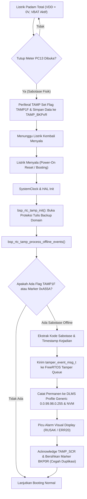

# Panduan & Arsitektur Deteksi Sabotase Saat Meter Mati (Offline Tamper)
## STM32U575 RTC / TAMP Backup Domain ($V_{BAT}$)
**Kepatuhan Standar: SPLN D3.006: 2021 Bagian 5 & Tabel 6**

---

## 1. Latar Belakang & Landasan Regulasi PLN

Berdasarkan regulasi resmi **PLN SPLN D3.006: 2021 Bagian 5 (Persyaratan Pengamanan dan Anti-Sabotase)** dan **Tabel 6 (Daftar Kejadian Sabotase & Tindakan Meter)**:
1. **Kejadian Pembukaan Tutup Meter (*Meter Cover Open / Case Open*)**:
   - Status: Kategori Kritis / Fatal (**RUSAK**).
   - Persyaratan Wajib: Meter harus mampu mendeteksi dan mencatat kejadian pembukaan tutup meter **dalam segala kondisi**, baik saat meter bertegangan normal maupun **saat meter padam total (*unpowered / mains dead*)**.
   - Tindakan: Relai pemutus (*contactor*) wajib trip/terbuka permanen, lampu LED alarm berkedip, display LCD menampilkan tulisan **"RUSAK"**, dan kejadian dicatat ke dalam logbook DLMS Class 7 Tamper Profile Generic (`0.0.99.98.0.255`).
2. **Kejadian Pembukaan Tutup Terminal (*Terminal Cover Open*)**:
   - Status: Kategori Peringatan (**ERR20**).
   - Persyaratan Wajib: Harus terdeteksi dan tercatat timestamp kejadiannya meskipun catu daya utama sedang padam.

Ketika listrik PLN padam total, prosesor utama (ARM Cortex-M33 core) dan periferal berdaya tinggi berada dalam kondisi non-aktif (mati). Untuk memenuhi standar regulasi di atas, mikrokontroler STM32U575 harus mengandalkan **Domain Baterai Cadangan ($V_{BAT}$)** dan modul periferal mandiri **TAMP (Tamper and Backup Registers)**.

---

## 2. Arsitektur Hardware & Domain Daya $V_{BAT}$

```
+-------------------------------------------------------------------------+
|                              SMART METER                                |
|                                                                         |
|  +--------------------+                    +-------------------------+  |
|  | Catu Daya PLN      |                    | Baterai Litium ER14250  |  |
|  | AC 230V / 400V     |                    | 3.6V Primary Cell       |  |
|  +---------+----------+                    +------------+------------+  |
|            |                                            |               |
|            v (Mati / Padam)                             v (Selalu Aktif)|
|     [ VDD = 0V ]                                 [ VBAT = 3.6V ]        |
|            |                                            |               |
|            |                                            v               |
|            |                              +---------------------------+ |
|            |                              | STM32U575 Backup Domain   | |
|            |                              | - Konsumsi arus < 500 nA  | |
|            |                              | - LSE Crystal (32.768 kHz)| |
|            |                              | - RTC Counter             | |
|            |                              | - 32x Backup Reg (BKPxR)  | |
|            |                              | - Periferal TAMP (TAMP1)  | |
|            |                              +-------------+-------------+ |
|            |                                            |               |
|            |    Microswitch Tutup Fisik Meter           |               |
|            +--- [ PC13 / TAMP_IN1 ] --------------------+               |
|                 (Active Low / Falling Edge)                             |
+-------------------------------------------------------------------------+
```

### Spesifikasi Teknis Domain Backup:
- **Sumber Daya:** Baterai Litium Thionyl Chloride ($Li-SOCl_2$) ER14250 3.6V (1200 mAh).
- **Arus Siaga (*Standby Current*):** $< 500\text{ nA}$ pada domain $V_{BAT}$, menjamin masa pakai baterai $> 15\text{ tahun}$.
- **Pin Deteksi Fisik:** `PC13` yang terhubung secara internal ke kanal hardware `TAMP_IN1`. Pin ini dilengkapi filter digital anti-glitch dan sirkuit pendeteksi transisi level logika yang beroperasi independen dari clock CPU utama.
- **Penyimpanan Status Sementara:** 32 buah register 32-bit (`TAMP_BKP0R` hingga `TAMP_BKP31R`) yang isinya **tidak hilang** selama pin $V_{BAT}$ memiliki tegangan baterai.

---

## 3. Alokasi Register Cadangan (TAMP Backup Registers)

Untuk menjaga kompatibilitas legal metrology dan kemudahan ekstraksi saat proses booting, alokasi register backup didefinisikan sebagai berikut:

| Register | Nama Konfigurasi | Deskripsi / Format Data |
| :--- | :--- | :--- |
| `TAMP_BKP0R` | `TAMP_BKP_REG_TAMPER_FLAG` | Bit [31:16] = Magic Marker (`0xA55A`), Bit [7:0] = Kode Sabotase DLMS |
| `TAMP_BKP1R` | `TAMP_BKP_REG_TIMESTAMP` | Nilai detik Unix Epoch saat sabotase terjadi |
| `TAMP_BKP2R` | `TAMP_BKP_REG_COUNTER` | Akumulator jumlah kejadian sabotase offline |
| `TAMP_BKP3R` s/d `BKP31R` | *Reserved* | Cadangan parameter metrologi kritis / signature |

---

## 4. Alur Kerja Firmware (State & Flowchart)



---

## 5. Implementasi Driver (`bsp_rtc_tamp.c` & `bsp_rtc_tamp.h`)

### 5.1. Inisialisasi & Pembukaan Akses Domain Backup
Pada mikrokontroler STM32, register Backup Domain secara default terkunci dari penulisan tidak disengaja. Driver membuka proteksi ini saat boot:
```c
void bsp_rtc_tamp_init(void) {
#if defined(EMBEDDED_HARDWARE_TARGET) || defined(USE_FREERTOS)
    __HAL_RCC_PWR_CLK_ENABLE();
    HAL_PWR_EnableBkUpAccess();
    __HAL_RCC_RTCAPB_CLK_ENABLE();

    if ((TAMP->CR1 & TAMP_CR1_TAMP1E) == 0U) {
        TAMP->CR1 |= TAMP_CR1_TAMP1E; /* Aktifkan input TAMP1 pada PC13 */
    }
#endif
}
```

### 5.2. Ekstraksi Kejadian & Dispatching ke RTOS
Saat fungsi `bsp_rtc_tamp_process_offline_events()` dipanggil di awal fungsi `main()`, firmware mengecek isi register:
1. Validasi bit `TAMP_SR_TAMP1F` dan magic marker `0xA55A0000`.
2. Jika terdeteksi kejadian offline, pesan `tamper_event_msg_t` dibuat dan dikirim ke `tamper_event_queue` FreeRTOS.
3. Layar LCD/OLED langsung disegarkan via `display_task_trigger_instant_refresh(true)`.
4. Flag status dihapus menggunakan `TAMP->SCR = TAMP_SCR_CTAMP1F` untuk memastikan sifat *single-shot* (tidak terjadi pelaporan berulang saat reboot berikutnya).

---

## 6. Prosedur Uji Coba & Verifikasi

### 6.1. Pengujian Interaktif via Konsol UART (CLI)
Pengujian offline tamper dapat disimulasikan secara langsung pada hardware maupun host simulator:
1. Hubungkan port serial UART1 / ST-Link VCP pada baudrate **115200 bps, 8-N-1**.
2. Ketik karakter `'o'` atau `'O'`.
3. Output terminal akan menampilkan log verifikasi berikut:
```text
[SIMULASI] Injeksi Sabotase Tutup Meter Saat Listrik Mati (Offline Tamper SPLN)!
[SIMULASI OFFLINE] Sabotase disimulasikan terjadi saat listrik mati (Code: 0x01, Time: 120 s).

======================================================================
 [OFFLINE TAMPER] *** PERINGATAN: SABOTASE TERDETEKSI SAAT LISTRIK MATI! ***
                 Status: TUTUP METER TERBUKA (RUSAK)
                 Waktu Kejadian (Epoch): 120 detik
                 Kanal Fisik: TAMP1 (PC13 Microswitch)
                 Kepatuhan: Standar SPLN D3.006: 2021 Bagian 5
======================================================================
[TAMPER TASK] Event diterima: Code=0x01, Active=1
[TAMPER LOG] Event dicatat: Code 0x01, State: AKTIF, Timestamp: 120
[DISPLAY] Layar disegarkan seketika: Status RUSAK ditampilkan!
```

### 6.2. Pengujian Otomatis CTest (`test_bsp_rtc_tamp`)
Suite pengujian unit otomatis telah ditambahkan ke sistem build CTest (`test_bsp_rtc_tamp`):
- Memverifikasi inisialisasi awal (tidak ada tamper palsu).
- Memverifikasi pembacaan & penulisan 32 register backup.
- Memverifikasi mekanisme marker `0xA55A0000` dan ekstraksi timestamp.
- Memverifikasi transfer event ke antrean RTOS dan pencatatan ke DLMS Logbook.
- Memverifikasi penghapusan flag pemulihan (*single-shot clear*).

**Hasil Uji CTest:**
```text
test_bsp_rtc_tamp ................ Passed (100% Lulus, 22/22 Test Suites Passed)
```

---

## 7. Rangkuman Kepatuhan Standar

| No | Parameter Kepatuhan | Standar SPLN D3.006: 2021 | Status Implementasi Firmware |
| :---: | :--- | :--- | :---: |
| 1 | Deteksi Saat Meter Padam | Bagian 5, Pasal 7 | **TERPENUHI** (Hardware TAMP & $V_{BAT}$) |
| 2 | Perlindungan Data Timestamp | Bagian 5 & Tabel 6 | **TERPENUHI** (Register `TAMP_BKP1R`) |
| 3 | Integrasi Log DLMS Class 7 | OBIS `0.0.99.98.0.255` | **TERPENUHI** (`dlms_tamper_log_record`) |
| 4 | Respon Layar & Alarm | Menampilkan "RUSAK" | **TERPENUHI** (`display_task` Refresh) |
| 5 | Ketahanan Terhadap Reset | Single-Shot Clear | **TERPENUHI** (Clearing via `TAMP_SCR`) |

