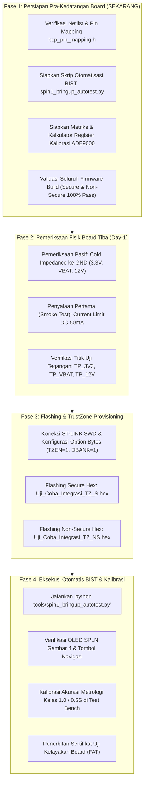

# Panduan Strategis & SOP Bring-Up Hardware PCB Spin 1

Dokumen ini memuat peta jalan langkah kerja (*actionable roadmap*), standar operasional prosedur (SOP), dan persiapan teknis bagi tim rekayasa perangkat lunak dan perangkat keras (*E3 Software & Hardware Team*) sambil menunggu kedatangan fisik **PCB Spin 1 Smart Meter 3-Fasa STM32U575 + ADE9000**.

---

## 1. Peta Jalan Langkah Kerja (*Actionable Roadmap*)



---

## 2. Rincian 4 Aktivitas Utama Selagi Menunggu Board

### Aktivitas 1: Membekukan Tooling Otomatisasi Uji BIST & Flashing
* **Skrip Otomatisasi Baru:** [`tools/spin1_bringup_autotest.py`](file:///g:/PPPP/Day_Sekian/Uji_Coba_Integrasi_TZ/tools/spin1_bringup_autotest.py) telah selesai dibuat.
* **Manfaat:** Ketika board fisik tiba di meja teknisi, teknisi tidak perlu mengetik perintah manual satu per satu di serial monitor. Cukup colokkan USB ST-LINK dan jalankan:
  ```powershell
  python tools/spin1_bringup_autotest.py --export
  ```
  Dalam 10 detik, skrip akan menguji bus I2C, SPI ADE9000, relai PC8/PC9, buzzer PB7, sensor sabotase PC13, tegangan PVD, memori NVRAM, dan watchdog supervisor, serta otomatis mengekspor berkas laporan berita acara ke folder `reports/`.

---

### Aktivitas 2: Audit Silang Skematik Akhir vs `bsp_pin_mapping.h`
Pastikan tidak ada diskrepansi antara skematik akhir PCB yang dikirim ke fabrikasi (*Gerber/BOM*) dengan kode firmware pada [`bsp_pin_mapping.h`](file:///g:/PPPP/Day_Sekian/Uji_Coba_Integrasi_TZ/firmware/drivers/bsp/inc/bsp_pin_mapping.h):

| Sinyal Fungsional | Pin MCU STM32U575 | Tipe I/O | Keterangan Sirkuit Hardware |
| :--- | :---: | :---: | :--- |
| **Buzzer Alarm** | `PB7` | Output PWM/Push-Pull | Driver NPN Transistor ke Buzzer 3.3V |
| **Relai Trip (Open)** | `PC8` | Output Pulsa 100ms | Driver MOSFET N-Channel Coils Relai |
| **Relai Close** | `PC9` | Output Pulsa 100ms | Driver MOSFET N-Channel Coils Relai |
| **ADE9000 IRQ0** | `PB0` | Input EXTI Falling | Pull-up $10\text{ k}\Omega$ ke 3.3V (Reverse, Power Order) |
| **ADE9000 IRQ1** | `PB1` | Input EXTI Falling | Pull-up $10\text{ k}\Omega$ ke 3.3V (Sag, Missing Neutral) |
| **Tamper Case Open** | `PC13` | Input EXTI / TAMP1 | Secure World EXTI13, Microswitch penutup meter |
| **OLED I2C1 (SCL/SDA)** | `PB8` / `PB9` | Open-Drain I2C | Resistor pull-up eksternal $4.7\text{ k}\Omega$ ke 3.3V |
| **ADE9000 SPI1** | `PA4`..`PA7` | SPI Full Duplex | SCK, MISO, MOSI, NSS (ADE9000 Chip Select) |
| **Konsol ST-LINK VCP** | `PA9` / `PA10` | USART1 (115200) | Jalur TX/RX ke IC debugger ST-LINK |
| **Port Modem WAN** | `PA2` / `PA3` | LPUART1 (19200-115200) | Jalur komunikasi serial kompartemen modem |

---

### Aktivitas 3: Matriks Register Kalibrasi ADE9000 Sesuai SPLN D3.006
Untuk persiapan pengujian meja kalibrasi (*Meter Test Bench* ZERA / MTE / Calmet), siapkan tabel kalkulasi register kalibrasi:

#### 1. Formula Kalibrasi Tegangan & Arus (Gain Calibration):
$$\text{xVGAIN} = \left( \frac{V_{\text{actual}}}{V_{\text{measured}}} - 1 \right) \times 2^{27}$$
$$\text{xIGAIN} = \left( \frac{I_{\text{actual}}}{I_{\text{measured}}} - 1 \right) \times 2^{27}$$

#### 2. Formula Kalibrasi Sudut Fasa (Phase Compensation pada PF = 0.5 Lagging):
$$\text{xPHCAL} = \frac{\Delta\theta \times 2^{27}}{\omega \times T_s}$$
*Digunakan untuk mengeliminasi keterlambatan fasa (*phase shift*) yang diinduksi oleh Current Transformer (CT) atau filter RC analog pada input metrologi.*

#### 3. Titik Uji Wajib Laboratorium Kalibrasi:
1. **Titik 1 (Arus Nominal):** $I = 100\% I_b$, $V = 230\text{ V}$, $\cos\phi = 1.0$ (Batas eror $\le \pm 0.5\%$).
2. **Titik 2 (Arus Rendah):** $I = 5\% I_b$, $V = 230\text{ V}$, $\cos\phi = 1.0$ (Batas eror $\le \pm 1.0\%$).
3. **Titik 3 (Faktor Daya Induktif):** $I = 100\% I_b$, $V = 230\text{ V}$, $\cos\phi = 0.5\text{ Lag}$ (Batas eror $\le \pm 1.0\%$).

---

### Aktivitas 4: Menyiapkan Alat & Instrumen Laboratorium
Sebelum board mendarat, pastikan perangkat keras pendukung berikut sudah berada di meja kerja:
1. **DC Power Supply (Benchtop Adjustable):** 0-30V dengan fitur *current limit* yang presisi (atur pada 12.0V, limit 50mA).
2. **Multimeter Digital (DMM):** Untuk pengecekan hambatan pasif (*continuity/impedance test*).
3. **Debugger ST-LINK V3 / V2-1:** Dilengkapi kabel konektor ribbon 10-pin atau 4-pin SWD (SWDIO, SWCLK, GND, 3V3, NRST).
4. **Kabel USB-UART (FTDI / CP2102):** Untuk menyadap komunikasi port modem (LPUART1) secara independen.
5. **Probe Optik Inframerah (IEC 62056-21):** Untuk pengujian port optik depan (INT-05 @ 9600 bps).

---

## 3. SOP Hari-H Kedatangan Board Spin 1 (Day-1 Bring-Up Protocol)

> [!CAUTION]
> **JANGAN LANGSUNG MENANCAPKAN CATU DAYA ATAU KABEL TEGANGAN TINGGI (230V AC) KETIKA BOARD BARU TIBA DARI PABRIK!**
> Lakukan tahapan verifikasi pasif berikut terlebih dahulu:

### Langkah 1: Pemeriksaan Hambatan Dingin (*Cold Resistance Test*)
Gunakan Multimeter pada mode $\Omega$ (Ohm), letakkan probe hitam di Ground (`DGND`):
* Ukur pin `+3.3V`: Hambatan harus **$> 1\text{ k}\Omega$** (Jika mendekati $0\ \Omega$, board mengalami korsleting pada kapasitor decoupling atau IC MCU).
* Ukur pin `VBAT`: Hambatan harus **$> 100\text{ k}\Omega$**.
* Ukur pin `+12V` (Koil Relai): Hambatan harus **$> 10\text{ k}\Omega$**.

### Langkah 2: Uji Catu Daya Awal (*Smoke Test*)
1. Hubungkan DC Power Supply 12.0V dengan batasan arus (*current limit*) **50 mA**.
2. Nyalakan catu daya:
   * Konsumsi arus normal: **$15\text{ mA} - 35\text{ mA}$**.
   * Jika arus menyentuh batas limit 50 mA dan tegangan drop: **SEGERA MATIKAN CATU DAYA!** Periksa orientasi IC regulator LDO/SMPS.
3. Ukur titik uji tegangan internal:
   * Titik `DVDD_3V3`: $3.30\text{ V} \pm 5\%$ ($3.14\text{ V} - 3.46\text{ V}$).
   * Titik `VDD_ADE`: $3.30\text{ V} \pm 5\%$.
   * Titik `REFP` ADE9000 (Tegangan Referensi Internal): $1.25\text{ V} \pm 1\%$.

### Langkah 3: Flashing Firmware TrustZone Lengkap
Jalankan skrip flashing melalui terminal:
```powershell
# 1. Flash Secure World (Area 0x08000000)
STM32_Programmer_CLI -c port=SWD -w Secure/build/Uji_Coba_Integrasi_TZ_S.hex -v

# 2. Flash Non-Secure World (Area 0x08100000)
STM32_Programmer_CLI -c port=SWD -w NonSecure/build/Uji_Coba_Integrasi_TZ_NS.hex -v -hardRst
```

### Langkah 4: Eksekusi Uji Kelayakan Otomatis
```powershell
python tools/spin1_bringup_autotest.py --export
```
Pantau seluruh pengujian hingga muncul banner:
`[SEMPURNA] SELURUH SUB-SISTEM PCB SPIN 1 LOLOS UJI BRING-UP!`
Layar OLED panel depan akan menampilkan **Page 01: IDPEL 530000000001** sesuai standar tampilan SPLN Gambar 4.

